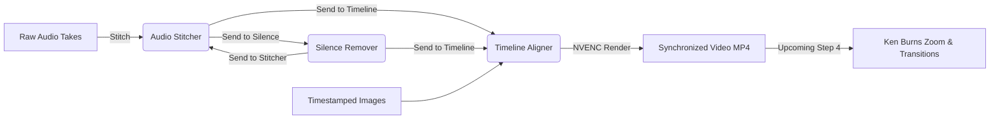

# Video Helper Studio — AI Developer & Architecture Guide

> **Target Audience**: AI Agents, LLM Coding Assistants, and Human Developers working on this codebase.  
> **Purpose**: This document explains every internal system, data contract, threading rule, and critical gotcha in this application. Read this thoroughly before modifying or adding any feature to ensure zero regressions and maintain 100% stability.

---

## 1. Executive Overview & System Architecture

**Video Helper Studio** is a modern, standalone desktop creative suite designed for YouTube Automation creators. It automates high-friction video and voiceover editing workflows.

### High-Level Tech Stack
- **Desktop Runtime**: `pywebview` (Chromium WebView2 on Windows) running a borderless/styled desktop window. **No `.bat` launchers, no default browser tabs.**
- **Backend API**: Python 3.11 with `ApiBridge` directly exposed to the frontend via `pywebview.api`.
- **Local Streaming Server**: Embedded `Bottle` server on `127.0.0.1` providing byte-range streaming for audio (`/stream_audio`), video (`/stream_video`), image thumbnail delivery (`/stream_image`), and multipart file ingestion (`/upload_audio`, `/upload_images`).
- **Core Processing Engines**: Embedded FFmpeg v7.1 (`resources/ffmpeg/ffmpeg.exe`) with **NVIDIA GeForce RTX 3060 12GB NVENC hardware acceleration** and CPU fallbacks.
- **Frontend Layer**: Vanilla HTML5, modern CSS3 (Tailored HSL design system with Dark Obsidian and Crisp Light modes), and ES6 JavaScript (`app.js`).
- **Packaging**: PyInstaller standalone bundle generated via `build_exe.py` and `VideoHelper.spec` outputting to `dist/VideoHelper/VideoHelper.exe`.

---

## 2. Directory & File Layout

```text
A:\My Video Hwelper APP\
├── build_exe.py                  # PyInstaller build runner script
├── VideoHelper.spec              # PyInstaller bundle specification
├── debug_log.txt                 # Unified diagnostic log (stdout/stderr/client JS/threading)
├── requirements.txt              # Python dependencies
├── README.md                     # User-facing summary
├── AI_DEVELOPER_GUIDE.md         # THIS FILE (Comprehensive engineering manual)
├── resources/
│   └── ffmpeg/
│       └── ffmpeg.exe            # Bundled standalone FFmpeg v7.1 binary
├── src/
│   ├── main.py                   # Application entry point & logging initializer
│   ├── core/
│   │   ├── ffmpeg_utils.py       # FFmpeg locator & audio/video metadata extractor
│   │   ├── audio_stitcher.py     # Engine 1: Multi-clip concatenation & LUFS mastering
│   │   ├── silence_remover.py    # Engine 2: FFmpeg silencedetect, voice buffer, trimming
│   │   ├── timeline_aligner.py   # Engine 3: Timestamp parsing, duration math, NVENC render
│   │   └── logger.py             # Diagnostic logging engine capturing all errors
│   └── gui/
│       ├── window.py             # Pywebview desktop window creation & splash screen
│       ├── api_bridge.py         # Python <-> JS Bridge (Methods callable from app.js)
│       ├── server.py             # Local Bottle streaming & file upload server
│       ├── dialog_utils.py       # Isolated PowerShell native file dialog pickers
│       └── web/
│           ├── index.html        # App layout (Splash screen, Sidebar, 3 Engine views)
│           ├── style.css         # Modern Obsidian design tokens, glassmorphism, animations
│           └── app.js            # Frontend controller (State, sliders, events, API calls)
└── tests/
    ├── test_stitcher.py          # Integration test for Audio Stitcher
    ├── test_silence.py           # Integration test for Silence Remover
    └── test_timeline.py          # Integration test for Timeline Aligner & NVENC video
```

---

## 3. The 3 Core Workflow Engines

### Engine 1: Audio Stitcher & Master Voiceover Builder (`src/core/audio_stitcher.py`)
- **Goal**: Merge multiple voiceover takes/clips into one master track with uniform pacing and YouTube loudness.
- **Inputs**: List of audio file paths (`.mp3`, `.wav`, `.m4a`, `.aac`, `.flac`, `.ogg`).
- **Configurable Settings**:
  - `gap_sec` (float, default `0.3s`): Artificial pause inserted between clips (using FFmpeg `anullsrc`).
  - `normalize_audio` (bool, default `True`): Normalizes audio to **EBU R128 (`-16 LUFS`, `-1.5 dB True Peak`, `LRA=11`)**.
  - `sample_rate` (int, default `48000 Hz`).
  - `output_format` (`mp3`, `wav`, `m4a`).
  - `bitrate_kbps` (default `320 kbps`).
- **Features**: Drag-to-reorder, Move Up/Down, Natural sorting (`1.wav`, `2.wav`, `10.wav`), inline play/pause preview.
- **Pipeline Output**: Emits `window.onStitchComplete(result)`. Master audio is immediately playable and can be sent to the Silence Remover or Timeline Aligner with 1 click.

### Engine 2: Audio Silence Remover (`src/core/silence_remover.py`)
- **Goal**: Strip dead air, pauses, and unvoiced gaps from raw voiceover takes while strictly preserving speech edges.
- **Inputs**: A single voiceover file path.
- **Configurable Settings**:
  - `threshold_db` (float, default `-40 dB`): Volume level below which sound is considered dead air.
  - `min_duration_sec` (float, default `0.4s`): Pauses shorter than this duration are kept for natural breathing.
  - `margin_ms` (float, default `80 ms`): **Safety voice buffer** added to the start and end of every voice segment so word endings and breath tails are never clipped.
  - `normalize_audio` (bool, default `True`): EBU R128 `-16 LUFS` YouTube loudness mastering.
- **Internal Processing**:
  1. Runs `silencedetect` via FFmpeg to find intervals `[start, end]`.
  2. Inverts intervals into speech segments and expands boundaries by `margin_ms`.
  3. Merges overlapping windows and builds an FFmpeg `atrim` + `concat` filtergraph.
- **Telemetry UI**: Displays detected pauses count, total dead air cut, and lists individual intervals (`00:02.30 ➔ 00:04.55 (-2.25s)`).
- **Pipeline Output**: Emits `window.onSilenceComplete(result)`. Result can be sent directly to Stitcher or Timeline Aligner.

### Engine 3: Smart Timeline Image Aligner (`src/core/timeline_aligner.py`)
- **Goal**: Automatically map timestamped still images to the voiceover audio track and render an MP4 video rough-cut.
- **Inputs**: Voiceover audio file + batch of still images (`.png`, `.jpg`, `.jpeg`, `.webp`, `.bmp`).
- **Timestamp Parsing**: Supported patterns in filenames:
  - `image-1_00:00.png`, `image-2_00:05.jpg`, `image_1_00:00.png` (with index prefixes)
  - `00:00.png`, `01:23.jpg`, `01:05:20.png`
  - `00_00.png`, `01_23.jpg`, `00_15_500.png`
  - `00-00.png`, `01-23.jpg`
  - `0000.png`, `0130.jpg` (4-digit `MMSS`)
  - `scene_01_23.png`, `0015_battle.jpg`
- **Timing Logic**:
  - Image #1 starts at `00:00.00` and displays until Image #2's timestamp begins.
  - Image `i` duration is `start[i+1] - start[i]`.
  - The final image holds until the voiceover audio ends (no black frames).
- **Video Rendering**:
  - Creates a temporary FFmpeg concat demuxer manifest file.
  - Fits and letterboxes/pillarboxes images cleanly to 16:9 canvas with black padding.
  - **Hardware Acceleration**: Encodes using `h264_nvenc` (NVIDIA RTX 3060) at preset `p4`, with automatic fallback to `libx264`.
  - Output resolutions: `1080p Full HD`, `4K UHD`, or `720p Draft` at `24, 30, or 60 FPS`.
- **Exporters**:
  - Direct MP4 video previewable inside the app with `<video>` player.
  - CSV Cue Sheet export for direct import into Premiere Pro / DaVinci Resolve.

---

## 4. Cross-Engine Pipeline Integration

The engines form an interconnected assembly line:


### Passing State Between Views:
- **`lastStitchedResult`**: `{ path, filename, duration, duration_formatted, format_name, sample_rate, size_formatted }`
- **`lastSilenceResult`**: Same contract as `lastStitchedResult`.
- **`setSilenceActiveFile(clip)`**: Loads any clip into the Silence Remover and triggers pause analysis.
- **`setTimelineActiveAudio(audioMeta)`**: Loads any audio clip into the Timeline Aligner reference slot and recalculates image timing.
- **`switchTab(tabName)`**: Toggles visibility between `'stitcher'`, `'silence'`, and `'timeline'` views.

---

## 5. Critical Architectural Rules & Gotchas (MUST READ)

### ⚠️ RULE 1: Leading Underscore for ApiBridge Attributes
`pywebview` reflects on `dir(js_api)` to expose backend methods to the frontend.
**DO NOT** declare public instance attributes on `ApiBridge` without a leading underscore:
```python
# WRONG - Triggers Windows COM apartment thread deadlock (22+ second freeze)
self.window = window
self.stitcher = AudioStitcher()

# CORRECT
self._window = window
self._stitcher = AudioStitcher()
self._silence_remover = AudioSilenceRemover()
self._timeline_aligner = TimelineAligner()
```
If an attribute is public, pywebview attempts to inspect it recursively. If it inspects `window.native` (the underlying COM object), Windows COM Apartment cross-thread timeouts cause the entire application to hang with "Not Responding".

### ⚠️ RULE 2: Bottle MEMFILE_MAX Must Be 1 GB
Bottle's default `BaseRequest.MEMFILE_MAX` is only **100 KB**. Any audio or image upload exceeding 100 KB will fail with an HTTP 413 HTML error page and break frontend JSON parsing.
Always ensure in `src/gui/server.py`:
```python
bottle.BaseRequest.MEMFILE_MAX = 1024 * 1024 * 1024  # 1 GB
```

### ⚠️ RULE 3: NEVER Use `tkinter.Tk()` For File Dialogs
Calling `tkinter.filedialog` from pywebview callbacks deadlocks the COM message loop in WebView2.
Always use `src/gui/dialog_utils.py`, which executes isolated PowerShell subprocesses:
```python
# dialog_utils.py uses isolated PowerShell STA subprocess
def pick_save(default_name): ...
```
For file inputs in the web UI, use hidden `<input type="file">` elements which trigger natively without thread locking.

### ⚠️ RULE 4: Media Streaming Over HTTP (CORS & Path Security)
WebView2 blocks direct `file:///C:/...` resource requests from web content.
Never set `<audio src="file:///...">` or ``.
Always use the local streaming endpoints in `server.py`:
- Audio: `/stream_audio?path=${encodeURIComponent(filePath)}`
- Video: `/stream_video?path=${encodeURIComponent(filePath)}` (Supports HTTP 206 byte-range seeking)
- Images: `/stream_image?path=${encodeURIComponent(filePath)}`

### ⚠️ RULE 5: Windows Subprocess Window Suppression
Whenever running FFmpeg via `subprocess.Popen` or `subprocess.run`, suppress the flashing black console window on Windows:
```python
startupinfo = None
if sys.platform == "win32":
    startupinfo = subprocess.STARTUPINFO()
    startupinfo.dwFlags |= subprocess.STARTF_USESHOWWINDOW
    startupinfo.wShowWindow = 0

proc = subprocess.Popen(cmd, startupinfo=startupinfo, ...)
```

### ⚠️ RULE 6: Diagnostic Logging to `debug_log.txt`
All stdout, stderr, uncaught Python exceptions, and frontend JavaScript errors (`window.onerror`, unhandled promise rejections via `/client_log`) are intercepted by `src/core/logger.py` and written to `debug_log.txt`.
When debugging unexpected behavior, inspect `debug_log.txt` first.

---

## 6. Upcoming Feature Roadmap

### Feature 4: Ken Burns Dynamic Zoom & Crossfade Transitions (Next Step)
- **Concept**: Add cinematic motion to the aligned still images to maintain viewer retention.
- **Components to Implement**:
  1. **Slow Zoom In / Zoom Out**:
     - Apply FFmpeg `zoompan` or smooth affine transformations to each still image segment (e.g. 1.0x ➔ 1.15x over the clip's duration).
     - Configurable zoom directions: Zoom In (Center), Zoom Out (Center), Pan Left-to-Right, Pan Right-to-Left.
  2. **Default Crossfade Transitions**:
     - Use FFmpeg `xfade=transition=fade:duration=0.5:offset=...` between consecutive images.
  3. **UI Controls**:
     - Presets: Subtle (5%), Cinematic (12%), Aggressive (20%).
     - Toggle between hard cuts and crossfades.

---

## 7. Build & Verification Commands

### Run Unit Tests:
```powershell
# Test Feature 1: Audio Stitcher
python tests/test_stitcher.py

# Test Feature 2: Audio Silence Remover
python tests/test_silence.py

# Test Feature 3: Smart Timeline Image Aligner
python tests/test_timeline.py
```

### Launch Application in Development Mode:
```powershell
python src/main.py
```

### Build the Standalone Executable (`dist/VideoHelper/VideoHelper.exe`):
```powershell
python build_exe.py
```

*Note: The executable bundles FFmpeg from `resources/ffmpeg/ffmpeg.exe` and web assets from `src/gui/web/` so the resulting `.exe` runs on any Windows machine without Python or external dependencies.*
